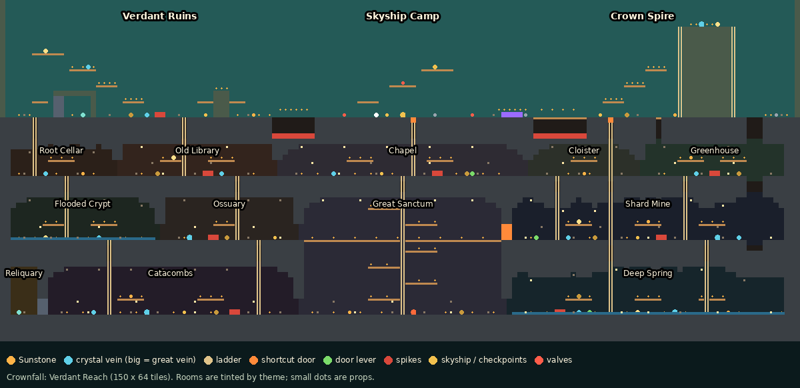
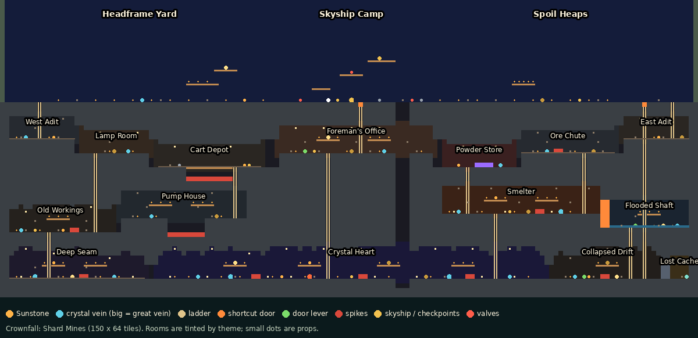

# Last Ride Up (Godot 4)

Co-op 2D platformer for phones: an expedition stranded in the ruins gathers enough Sunstone to power a crashed skyship and escape together. Hidden traitors spend Guile to sabotage the way out.

This is **Milestone 3: hidden traitors**, built on Milestone 2's online multiplayer, three maps and vein gathering. One Godot project contains the game client and a headless dedicated server. Both run the same rules code.

## Maps

The host picks a map in the lobby, or **Random** for a different one each round. Every map is 150 × 64 tiles with the same camp and mechanisms, but its own layout, look and centrepiece. Underground, each map is split into **named rooms**. Each room has a theme: its own colours, back-wall pattern (brick, planks, tiles, roots, crystal…), props (bookshelves, mine carts, reeds, chandeliers…), lights, and in some rooms water. `tools/check_map.py` proves each map is fully reachable and has no softlocks.

| Map | Character | Rooms |
|---|---|---|
| **Verdant Reach** | Ruins above, a sunken temple below, built around the two-storey **Great Sanctum** where the Heartstone rests. Arched halls, warm candlelight. | Root Cellar, Old Library, Chapel, Cloister, Greenhouse, Flooded Crypt, Ossuary, Great Sanctum, Shard Mine, Catacombs, Reliquary (secret), Deep Spring |
| **Shard Mines** | A V-shaped mine under a night sky. Two long declines of rooms step down from the west and east edges and meet at the wide **Crystal Heart** cavern at the bottom. The **Main Shaft** lift drops straight from camp to the Heart. Rails, carts and timber supports. | West Adit, Lamp Room, Cart Depot, Pump House, Old Workings, Deep Seam, Foreman's Office, Crystal Heart, Powder Store, Ore Chute, East Adit, Smelter, Flooded Shaft, Collapsed Drift, Lost Cache (secret) |
| **Hollow Marsh** | A misty bog with dead trees on the skyline. Lumpy root chambers and flooded pools, all reached from inside the giant **Hollow Tree**, climbed from its open top to the bottom. The most rooms and the most dead ends. | 20 rooms incl. Reed Bed, Old Boathouse, Heron Roost, Lantern Hollow, Frog Pond, Mushroom Grove, Eel Pool, Smugglers' Den, Glowworm Grotto, Bone Pit (secret), Sunken Shrine, Drowned Chapel, Root Maze, Rootheart, Black Water, Old Well |





> **Status:** runs in Godot 4.7.2. All 30 rule tests pass, the project imports with no script errors, and 10 clients have played a match together on one dedicated server. Snapshots are deflate-compressed and stay under one UDP packet even with 10 players (about 1.2 KB, checked by a test).

## Requirements

- Godot **4.7** (standard build, not .NET). It should also open in 4.3 to 4.6.
- For phone builds: Godot export templates, plus the Android SDK and/or Xcode.

## First run

```bash
# 1. Let Godot import the project and build its class cache (once, or open it in the editor)
godot --headless --path . --import

# 2. Rule tests (headless, exit code 0 = pass)
godot --headless --path . --script res://tests/run_tests.gd

# Map tools (Python 3, no Godot needed)
python3 tools/check_map.py          # proves every spot is reachable and nothing strands you, even fully loaded
python3 tools/build_maps.py         # regenerate scripts/sim/maps/*.gd from the designer script
python3 tools/render_map_preview.py # docs/map_<id>.png

# 3. Start a dedicated server (UDP port 24680 by default)
godot --headless --path . -- --server
godot --headless --path . -- --server --port 30000
```

Then run the game (F5 in the editor), type a name and press **Quick play** or **Create private room**. To play several clients on one machine, use **Debug → Customize Run Instances…** in the editor and set it to 3 or 4 instances.

**Phones on your Wi-Fi:** the server prints its LAN address at start-up, for example `192.168.1.20:24680`. Type that into **Server address** on the phone. Each player needs their own device or instance.

## Controls

| | Touch | Keyboard | Controller |
|---|---|---|---|
| Move | Drag anywhere on the left side | A/D or arrows | Left stick |
| Climb ladders | Drag up / down on a ladder | W/S or Up/Down | Left stick |
| Drop through planks | Drag down + Jump | S + Jump | |
| Jump (hold for higher) | Big button | Space / K (W / Up when not on a ladder) | A |
| Interact (Strike, Load, Open, Lift, Repair, Valve, Ring bell) | Labelled button | E / F / Enter | X |
| Sabotage (traitors only) | Violet buttons in the Guile panel | 1 Spikes, 2 Bridge, 3 Lift, 4 Taint, 5 Breach | |
| Quickstep dash | Arrows button | Shift / J | B |
| Map | Map button | M / Tab | Back |
| Menu | Menu button | Esc | Start |

Button size and a left-handed layout are in the in-game menu.

## How a match works

- **Verdant Reach** (the other maps work the same way): seven areas: the Skyship Camp, Verdant Ruins and Crown Spire on the surface; the Hollow Marsh, Sunken Hall, Shard Mine and Sunken Vault below. Ladders, one-way drops, false walls and loops connect them. Three **shortcut doors** open only from their far side, so the first trip is long and later ones are quick.
- **Crystal veins** are the main source of Sunstone. Strike one to crack it, and the Sunstone bursts out onto the floor. A **great vein** only cracks when two explorers strike together. Veins regrow after 50 seconds. Loose shards are a small extra.
- **Surges:** every minute or so a vein surges for 20 seconds. It gives double the Sunstone, cracks in half the strikes, and shows on the map.
- **Camp bounties:** three shared goals on the board, for example "crack 2 veins in the Shard Mine", "crack a great vein together" or "bring the Heartstone home". Each one adds a bonus to the charge.
- **Getting hurt:** spikes knock you back with a short stun and a moment of invulnerability. Falling into a pit glides you back out to your last safe ledge. Either way you spill some Sunstone where you can pick it up again.
- **Map (M or the Map button):** shows the layout, you, the skyship, unopened shortcut levers, surging veins, bounty areas and active sabotage. It does **not** show other explorers.
- **Explorers are animals.** Everyone in a room is a different one of ten (fox, rabbit, frog, bear, cat, panda, raccoon, owl, mouse, pig). **Customize** (menu or lobby) picks your preferred animal, one of ten hats and a face accessory. Animals and a few hats and faces are free; the rest are one-off purchases you can try on first. Everyone sees them, and they are remembered. You get your animal if nobody in the room has it, otherwise the next free one.
- Gather Sunstone. You can carry 100, and a fuller sack makes you slower and lower-jumping.
- Load it into the skyship's furnace at camp. The required charge grows with the number of players.
- **The Heartstone (150)** needs two players: one presses Lift and a second joins within 3 seconds. Carriers move slower and drop it if they split up.
- **Repairs are shared.** Everyone holding Interact at a broken bridge or jammed lift adds progress.
- When the charge is full the skyship lifts off. It leaves when everyone is aboard or after 30 seconds. The team wins if at least half got aboard.
- **Modes** (the host picks one in the lobby):
  - **No sabotage:** pure co-op.
  - **Test bot:** a hidden bot spends Guile on spikes, the bridge, the lift, engine breaches and secret vein taints. A tainted vein bursts into fool's stone, which weighs the same but is worth nothing at the furnace. The only clue is a faint violet sheen.
  - **Hidden traitors:** the server secretly makes 1 player a traitor (2 with 7 or more players). Your role is shown at the start and is never sent to anyone else's client. Traitors see each other's names in violet, earn Guile over time and spend it on the same sabotages (keys 1-5 or the Guile panel), with an 8-second lie-low after each one. Taint only works standing at a vein.
- **The meeting bell** stands at camp in Hidden traitors mode. Each player can ring it once per match (not in the first 20 seconds, and with a 25-second cooldown after each meeting). The match freezes for up to 40 seconds while everyone discusses and votes for a suspect or to skip. The player with the most votes is exiled only if they beat "skip" with no tie. Their role is revealed, they drop what they carry, and they stay in the match as a ghost.
- **Winning with traitors:** explorers win by escaping (only explorers count towards the half who must get aboard) or by exiling every traitor. Traitors win if the expedition is stranded. The end screen reveals every role and how many sabotages there were.

## Networking in one paragraph

The server is authoritative. Clients send only inputs (30 packets a second, unreliable, each repeating the last few frames so a lost packet costs nothing). The server steps the rules at 60 Hz and sends snapshots 20 times a second. Pickups, loads, sabotage, timers and wins are reliable events. Your own character is predicted locally with the same `CFSim.step_movement` the server runs, then reconciled when snapshots arrive. Other players are drawn 100 ms in the past, interpolated between snapshots. If you drop out, your seat is held for 60 seconds and you rejoin the running match. See `docs/decisions/0002-networking.md`.

## Sound

There are no audio files. The `Sfx` autoload (`scripts/client/sfx.gd`) builds every sound effect and a small set of instrument notes in a background thread when the game starts (about half a second), then plays music with a tiny step sequencer. Each mood has a key, tempo, chord loop and a seeded melody that repeats every 8 bars: `menu`, one per map (`verdant`, `mines`, `marsh`) and `escape` while the skyship lifts off. Other players' sounds fade with distance. Music and Sounds volumes are on the main menu and the in-game Menu, and are saved with the other settings. Sound is off on the dedicated server and in headless runs.

To use recorded audio instead, load your files into `_sounds` (effects, by name) and `_inst` (instrument notes pitched at C4, bass at C2) in place of the synthesised ones.

## Project layout

```text
project.godot            Godot 4.7, GL Compatibility renderer (best for phones), landscape
scenes/main.tscn         entry scene → scripts/main.gd
scripts/sim/             shared rules (no nodes, no network): CF config, CFSim, CFLevel, CFVeins, CFMaps, state classes
scripts/sim/maps/        one file per map (ASCII layout, rooms with themes, props, sky theme)
scripts/net/             Net autoload (all RPCs), CFRoom, CFSlot, CFWire
scripts/client/          CFGameClient (prediction, interpolation), CFWorldView (drawing), CFUI, CFTouchControls, CFMapOverlay,
                         Store (purchases), Sfx (sound effects and music, synthesised at start-up)
tests/run_tests.gd       headless rule tests
tools/                   lint_gd.py (static checks), build_maps.py / check_map.py / render_map_preview.py (maps)
docs/decisions/          architecture decision records
```

## Selling cosmetics

Free: every animal, the explorer's helmet and beanie, glasses and rosy cheeks. Every other hat and face is a one-off (non-consumable) purchase. Tier 2 (US$1.99) covers the crown, top hat, horned helmet and propeller cap; tier 1 (US$0.99) covers the rest (`CF.price_tier`). Google and Apple show their own local price once they answer. On Steam the server prices each item in the player's wallet currency (`PRICES` in `scripts/net/steam_shop.gd`, which covers every currency Steam supports).

Product ids are `hat_<item>` / `face_<item>`, e.g. `hat_crown`, `face_shades` (`CF.paid_products()` lists them all). Create the same ids in each store.

**The server decides what others see.** A paid hat or face is only shown to the room after the dedicated server has checked the purchase, so a modified client can't show items it hasn't bought:

- **Google Play.** Install the [GodotGooglePlayBilling](https://github.com/godot-sdk-integrations/godot-google-play-billing) addon (`addons/GodotGooglePlayBilling/`), then enable it and the Gradle build. Add each id as a one-time in-app product in Play Console. The game acknowledges purchases itself, and "Restore purchases" re-reads them from Play. The server checks Google's signature on each purchase: set `GOOGLE_PLAY_PUBLIC_KEY` (Play Console → Monetization setup → Licensing) and `GOOGLE_PLAY_PACKAGE`.
- **App Store.** Add the `InAppStore` plugin from [godot-ios-plugins](https://github.com/godot-sdk-integrations/godot-ios-plugins) to the iOS export, and create each id as a non-consumable in App Store Connect. The Restore purchases button is the one Apple requires. The server looks each transaction up with the App Store Server API. Set `APPLE_PRIVATE_KEY_PATH` (an In-App Purchase key `.p8`), `APPLE_KEY_ID`, `APPLE_ISSUER_ID` and `APPLE_BUNDLE_ID`. It tries production, then sandbox; override this with `APPLE_API_BASES`.
- **Steam.** Add GodotSteam and enable microtransactions for the app. The client signs in to the server with a Steam Web API ticket (identity `lastrideup`), and the server confirms it with `AuthenticateUserTicket`. The server then reads the player's currency, runs InitTxn/FinalizeTxn with the publisher key, and records purchases in `user://steam_purchases.json`. Set `STEAM_PUBLISHER_KEY` and `STEAM_APP_ID`. It uses the Steam sandbox until you also set `STEAM_SANDBOX=0`. Steam item ids are fixed in `CF.STEAM_ITEM_IDS`: give each new paid item a new id, and never reuse or renumber one.
- **Debug builds** with no store use a test store: purchases unlock at once and no money is taken. Other players only see test purchases on a server started with `--test-purchases`, so never use that flag on a public server. Release builds with no store let players try items on, but not buy them.

Example server: `STEAM_PUBLISHER_KEY=… STEAM_APP_ID=… GOOGLE_PLAY_PUBLIC_KEY=… GOOGLE_PLAY_PACKAGE=… APPLE_PRIVATE_KEY_PATH=… APPLE_KEY_ID=… APPLE_ISSUER_ID=… APPLE_BUNDLE_ID=… godot --headless --path . -- --server`. Each store is switched off when its settings are missing.

**Testing the server checks without real stores.** `tests/stores/mock_stores.py` (it needs Python's `cryptography` package) pretends to be the Steam and App Store APIs on port 8765, and it checks the server's Apple tokens with its own copy of the test key. `tests/stores/drive_stores.gd` then plays a client: Steam sign-in and buying, forged and genuine Google purchases, and App Store lookups. See the top of `drive_stores.gd` for the commands. `tests/fixtures/test_apple_key.p8` is a throwaway key made for these tests, not a real Apple key.

**Still to check with real accounts:** each store plugin inside a real exported build, and Apple's live API hosts. The GodotSteam signal *arguments* (the names are confirmed) are read defensively, so they work with either buffer format.

Store receipts are not tied to a game account. Someone who copies another player's Google purchase data or App Store transaction id could show those items too. Closing that gap needs player accounts.

## Exporting

- **Android / iOS:** Project → Export → add a preset. The project is already landscape and uses the GL Compatibility renderer.
- **Dedicated server:** add a Linux preset and set *Export Mode → Export as dedicated server*. Run it with `-- --server`. Host it anywhere that allows inbound UDP.

## Known gaps (next up)

- Art is procedural placeholder in the target palette, with Godot's default font. Audio is synthesised in code (chiptune-ish); real recordings can replace the samples later without touching the game code.
- Three maps, one character (Pip). Six characters come in Milestone 5. A fourth map, the Crown Spire tower, is planned.
- Evidence and witnesses (who was near a tainted vein or a sabotaged lever) come with deduction in Milestone 4. There is no in-game chat yet, so meetings rely on voice chat.
- Next for virality: an end-of-round replay that shows what the traitors really did, join-by-link with a web build, quick-chat and emotes, then sound and juice.
- There is no matchmaking service yet: Quick play fills public rooms on the one server you connect to.
- Inputs and snapshots use Godot's Variant encoding. Packing them into bytes is a later optimisation.
